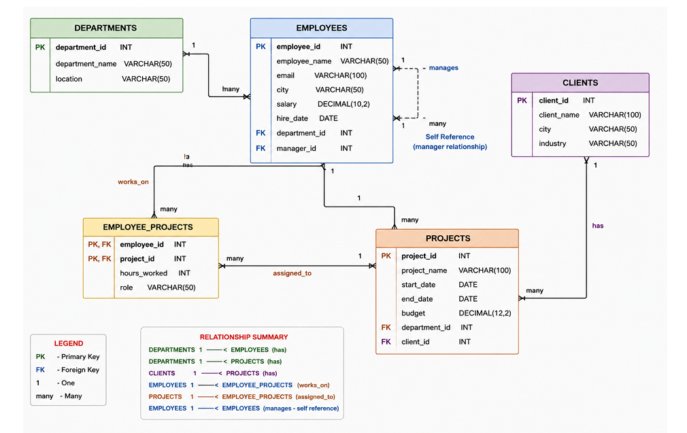

# Project Management Database

## Overview
A relational database designed to manage departments, employees, clients, projects, and employee project assignments using MySQL.

## Entity Relationship Diagram (ER Diagram)

The following diagram illustrates the relationships between departments, employees, clients, projects, and employee project assignments.

## Database Tables
- **DEPARTMENTS:** Stores department names and locations.
- **EMPLOYEES:** Stores employee details, salaries, department assignments, and manager relationships.
- **CLIENTS:** Stores client names, cities, and industries.
- **PROJECTS:** Stores project details, budgets, dates, departments, and associated clients.
- **EMPLOYEE_PROJECTS:** Tracks employee assignments, roles, and hours worked on projects.

## SQL Concepts Used
- Primary and foreign keys
- One-to-many relationships
- Many-to-many relationships
- Self-referencing relationships
- JOIN operations
- Aggregate functions and subqueries (where implemented)

## Project Files
- `project_management.sql` — Database schema and data
- `queries.sql` — SQL queries
- `ER_Diagram.png` — Entity Relationship Diagram

## Tools Used
- MySQL
- MySQL Workbench
- GitHub

## How to Run
1. Open MySQL Workbench and connect to your MySQL server.
2. Open `project_management.sql`.
3. Execute the script to create and populate the database.
4. Open `queries.sql` and execute the queries.

## Author
Kalluri Trivedh Sri Satya Sai.
